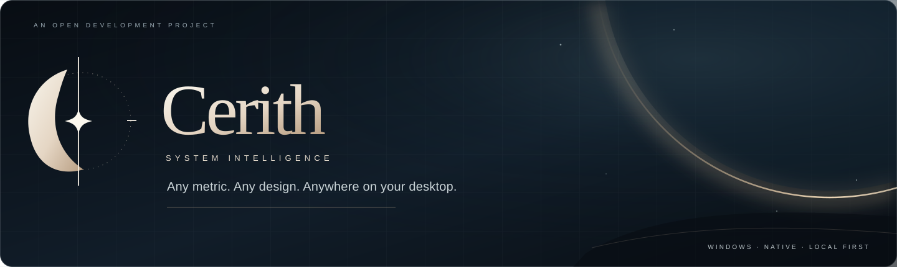
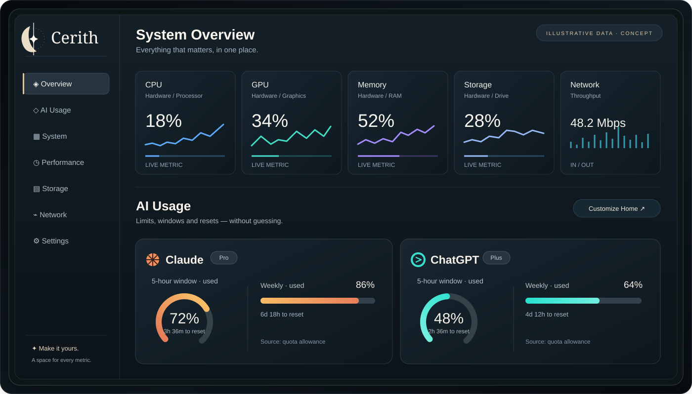

<div align="center">
  
</div>

<div align="center">

**Your system, in focus.**

A native Windows telemetry platform for hardware, gaming and AI usage — built around one idea: every real metric should work in any design, on any desktop surface.

**Windows** · **C# / .NET 10** · **WinUI 3** · **Local-first**

[Explore Cerith Home](#cerith-home) · [How it works](#one-metric-language-many-surfaces) · [Roadmap](#development-status) · [Contribute](#explore-the-project)

</div>

---

## Clarity at a glance. Depth when you need it.

Cerith brings three kinds of observability into one coherent native experience:

| **Hardware** | **Gaming** | **AI observability** |
| :--- | :--- | :--- |
| CPU, GPU, memory, storage, network and verified sensors. | FPS, frame time and measured game/session telemetry. | Subscription quotas, reset windows and local tool activity — without conflating them. |

Different sources. **The same truthful metric model.** Every surface consumes a `MetricId`, not a provider-specific UI implementation.

## Cerith Home

<div align="center">
  
</div>

> **Visual direction, not a product screenshot.** The interface and all numbers above are illustrative. Cerith Home is a proposed landing experience; it is **not** an implemented, working dashboard in the current milestone.

A calm, information-rich home for your desktop. Hardware readouts sit alongside clearly labelled AI allowance windows, with the most useful information immediately visible and deeper inspection one interaction away.

**Designed to become yours:** a polished first-run layout, followed by selectable metrics, movable and resizable sections, comfortable-to-compact density, themes and saved layouts. Narrow windows **reflow** their content rather than shrinking the entire UI to illegibility.

The orbital identity, restrained color, generous hierarchy and fine borders come from the **Cerith Home** design direction. Branding artwork belongs in the product identity; decorative scenery does not compete with live measurements inside the application.

[Read the visual direction and interaction contract →](docs/UI_UX.md#cerith-home--visual-direction)

## One metric language. Many surfaces.

```text
Hardware · PresentMon · AI quota/activity sources
                    │
             MetricSnapshot
                    │
          MetricRegistry / MetricBus
                    │
                  IPC
                    │
        MetricId-bound native components
                    │
   Home · Floating widgets · Taskbar · Tray · Overlay
```

Cerith is built **native-first**. The monitoring path is local, and the interface must not become the workload. Components can present data differently, but they cannot silently rewrite its meaning.

- **Truth before appearance.** Missing data is not zero. Estimated data is not measured data.
- **Privacy by default.** Local-first acquisition; no prompts, source code or credentials masquerading as telemetry.
- **Performance is measured.** Windows, DPI, accessibility and idle overhead are quality gates, not marketing claims.
- **Deep customization without the initial setup tax.** Useful defaults first; advanced composition for people who want it.

## Development status

**Active development · no public release yet.** This README distinguishes the shipped repository code from the design direction and roadmap.

| Milestone | State | Scope |
| :--- | :--- | :--- |
| **M0 · Foundation** | Complete | Metric contracts, runtime skeleton, IPC and project safeguards |
| **M1 · Hardware** | Complete | Initial native hardware acquisition |
| **M2 · Gaming** | Complete | PresentMon-based FPS, frame-time and session foundations |
| **M3 · AI telemetry** | Complete | Initial quota integrations and a bounded local activity collector |
| **M4 · Widget engine** | **In progress** | Native metric components, composition and compact surfaces |
| **M5 · Visual editor** | Planned | Drag, resize, layers, alignment and property inspector |
| **M6 · Rules & profiles** | Planned | Context-aware presentation and alerts |
| **M7 · History & analytics** | Planned | Retained data, trends, model breakdown and historical dashboards |

The current M4 branch work is reviewable in [pull requests](https://github.com/ParedesYTecho/Cerith/pulls); **a draft PR is not a completed feature on `main`**. See the [canonical roadmap](docs/ROADMAP.md) for full scope and acceptance criteria.

### How Home fits the roadmap

The visual idea is staged rather than promised all at once: **M4** supplies the honest metric components and native surfaces; **M5** supplies visual editing and saved composition workflows; **M6** can add contextual profiles; **M7** supplies real historical charts and token/cost analytics. No mockup chart implies a source or history store that does not yet exist.

## Explore the project

| Read | Why |
| :--- | :--- |
| [Product specification](docs/PRODUCT_SPEC.md) | Vision, surfaces and long-term scope |
| [UI / UX](docs/UI_UX.md) | Cerith Home, customization, density, motion and honest states |
| [Architecture](docs/ARCHITECTURE.md) | MetricId, providers, runtime and boundaries |
| [Metrics](docs/METRICS.md) | Units, confidence and telemetry semantics |
| [AI telemetry](docs/AI_TELEMETRY.md) | Quotas versus tokens and source limitations |
| [Roadmap](docs/ROADMAP.md) | Milestones and sequencing |
| [Contributing](CONTRIBUTING.md) | Branches, PR quality and verification |
| [Security](SECURITY.md) | Responsible handling and privacy |

**Development stack:** C#, .NET 10, WinUI 3 / Windows App SDK, LibreHardwareMonitor, PresentMon and SQLite where required. No Electron or browser engine in the always-on monitoring path.

Cerith is developed in a public repository, but the **final code, documentation and brand licensing decisions remain pending**. Consult the [open-source strategy](docs/OPEN_SOURCE_STRATEGY.md) before reusing code or brand assets. *Cerith* is a working product name until clearance is complete.

<div align="center">

**Any metric. Any design. Anywhere on your desktop.**

<sub>Native by design. Honest by default.</sub>

</div>
