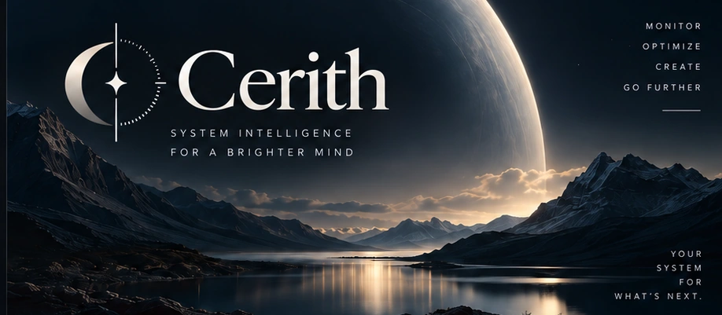
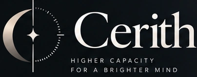

<div align="center">
  
  <h1>Cerith</h1>
  <p><strong>Any metric. Any design. Anywhere on your desktop.</strong></p>
  <p>Native Windows telemetry for the things you care about — your hardware, your games, and your AI tools.</p>
  <p>
    <a href="https://github.com/ParedesYTecho/Cerith/actions/workflows/build.yml"></a>
    <a href="https://github.com/ParedesYTecho/Cerith/actions/workflows/quality.yml"></a>
  </p>
  <p>
    <a href="#what-is-cerith">Overview</a> &nbsp;·&nbsp;
    <a href="#architecture">Architecture</a> &nbsp;·&nbsp;
    <a href="#development-roadmap">Roadmap</a> &nbsp;·&nbsp;
    <a href="#build-from-source">Build</a> &nbsp;·&nbsp;
    <a href="#contributing">Contribute</a>
  </p>
</div>

---

## What is Cerith?

Cerith is an **openly developed, Windows-first telemetry platform**. It brings hardware performance, gaming data and AI usage into one native system, so the same metric can appear as a readout, a graph, a compact desktop widget or — when implemented — another surface you choose.

The philosophy is simple: **powerful under the hood, calm on the desktop**. You should be able to start with a useful default, then control the information, appearance and placement without surrendering accuracy or performance.

| Hardware | Gaming | AI observability |
| :--- | :--- | :--- |
| CPU, GPU, memory, storage and network measurements from verified local sources. | FPS, frame time and performance telemetry with explicit measurement semantics. | Subscription allowances, reset windows and local tool activity, clearly separated from token costs and billing. |
| **Foundation delivered in M1.** | **PresentMon pipeline delivered in M2.** | **Initial quota and activity vertical slices delivered in M3.** |

The wider catalog is evolving. **Not every planned metric or surface is implemented today.**

## What makes it different

- **One metric, many presentations.** Components bind to stable `MetricId` contracts, not provider-specific widgets.
- **Native and local-first.** C#, .NET 10, WinUI 3 and Windows APIs; no Electron or browser engine in the always-on monitoring path.
- **Honest data.** Measured, estimated, stale, unavailable and error states are distinct. Unknown never silently becomes zero.
- **Built for customization.** Components and saved composition come before a future drag-and-drop visual editor.
- **Performance with evidence.** CPU, memory, DPI, keyboard access and lifecycle behavior are measured, not assumed.
- **Privacy is part of the architecture.** Local processing and IPC do not imply offline-only acquisition: some quota sources require authenticated HTTPS requests to their providers. Cerith does not operate a cloud telemetry backend, and a usage counter is not permission to collect prompts, source code or credentials.

## Architecture

```text
 Hardware          Gaming            AI sources
     └────────────────┼─────────────────┘
                      ▼
           Providers / acquisition
                      ▼
           MetricSnapshot + MetricBus
                      ▼
               Named-pipe IPC
                      ▼
             MetricId bindings
                      ▼
      Native components and surfaces
```

A widget never needs to know whether a metric came from a GPU sensor, PresentMon or an AI quota source. [Architecture](docs/ARCHITECTURE.md) · [Metric semantics](docs/METRICS.md) · [AI telemetry](docs/AI_TELEMETRY.md).

## Design, with purpose

Cerith's visual direction pairs an **orbital mark and editorial typography** with midnight tones, warm highlights and restrained motion. It is a brand exploration based on original project artwork, not a screenshot of a running application.

The product experience is intended to be **dense but calm**: readable hierarchy, purposeful motion, adaptable density, accessible states and layout that responds to actual window size and DPI. Its eventual Home view, editor and historical dashboards are specified in the roadmap; none is represented here by a fictional screenshot.

[Visual principles and interaction rules →](docs/UI_UX.md) · [Product vision →](docs/PRODUCT_SPEC.md)

## Development roadmap

**Under active development — no public installer or stable release yet.**

The repository has foundational hardware, gaming and AI telemetry implementations, with work continuing on native widget components and compact surfaces. Later phases introduce a visual editor, contextual rules, and retained history/analytics.

The **canonical milestone statuses and exit criteria live in [ROADMAP.md](docs/ROADMAP.md)**. Please consult that document and the [open pull requests](https://github.com/ParedesYTecho/Cerith/pulls) rather than treating a README summary or a draft PR as proof that a feature has shipped.

## Build from source

For contributors and developers on **Windows**, use the .NET 10 SDK and the Windows tooling required by WinUI 3. The commands below reflect the repository's [Build and Test workflow](.github/workflows/build.yml).

```powershell
git clone https://github.com/ParedesYTecho/Cerith.git
cd Cerith

dotnet restore Cerith.sln
dotnet build Cerith.sln --configuration Release --no-restore
```

Run the repository's three test projects:

```powershell
dotnet test tests/Cerith.Core.Tests/Cerith.Core.Tests.csproj --configuration Release --no-build
dotnet test tests/Cerith.Telemetry.Tests/Cerith.Telemetry.Tests.csproj --configuration Release --no-build
dotnet test tests/Cerith.Integration.Tests/Cerith.Integration.Tests.csproj --configuration Release --no-build
```

This is a **developer build**, not an installation or feature-completeness guarantee. Native runtime/DPI checks still require suitable Windows hardware and are tracked separately.

## Contributing

Cerith aims to be open to collaboration without compromising telemetry integrity or code quality. Contributions should be small, independently understandable and reviewable, with provenance for any external code.

Start with [CONTRIBUTING.md](CONTRIBUTING.md), [CODE_QUALITY.md](CODE_QUALITY.md), [SECURITY.md](SECURITY.md) and the [development workflow](DEVELOPMENT_WORKFLOW.md).

**Source availability is not a license grant.** The code, documentation and brand policies are still being finalized; see [Open Source Strategy](docs/OPEN_SOURCE_STRATEGY.md). The Cerith name and artwork are provisional pending clearance.

<div align="center">
  
  <p><sub>Native by design. Honest by default.</sub></p>
</div>
