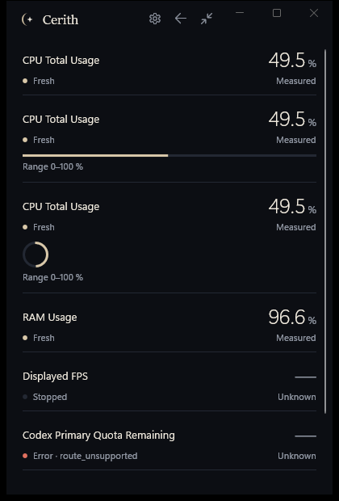

# Cerith UI / UX

## Goal

Cerith should eventually be recognizable from a screenshot.

External references expand the design vocabulary; they do not define the product.

## Principles

- dense but calm;
- clear hierarchy;
- immediate feedback;
- honest states;
- purposeful motion;
- excellent DPI support;
- keyboard and mouse first-class;
- accessible;
- premium without noise;
- highly configurable without requiring design expertise.

## Cerith Home — visual direction

**Status:** Future native landing-page direction, **not** an implemented screen or a new M4 exit requirement. The target is an editorial dashboard with legible hardware and AI summaries, adaptable navigation and honest status information.

The dashboard concept is intentionally **not included as a screenshot or promotional image** until an actual Home surface exists. The current [orbital hero](assets/cerith-hero.webp) and [logo lockup](assets/cerith-logo.webp) are brand studies cropped from user-supplied project artwork, not UI captures. The name and mark remain provisional pending clearance.

### Identity and hierarchy

- Retain the memorable crescent/orbit/star mark, serif wordmark and restrained midnight/ivory visual language as the **brand direction**. It is a proposal, not a finalized trademark or a license grant.
- The atmospheric planetary landscape belongs to banners and launch/brand material, **not** the live Home workspace; content and legibility take priority inside the app.
- Treat the left navigation as a scalable Home shell, not a mandatory sidebar in every widget. Keep a concise system/service health indicator and a discreet entry to Home customization.
- On a generous viewport, show a scannable row of real hardware metrics, then distinct AI allowance/activity areas; do not hardcode five cards or any provider as a permanent requirement.
- Use clear typography, measured contrast, restrained accents and subtle edge treatment. The reference artwork's tiny secondary text is not an accessibility target. Use state colors for meaning rather than decorating every value.

### Three distinct experiences

| Experience | User question | Density and interaction |
| --- | --- | --- |
| **Home** | What matters now across my system and tools? | Native landing page with customizable summaries and drill-down |
| **Floating/taskbar/tray/overlay** | What do I need to glance at without opening Cerith? | Purpose-built compact surfaces, with expansion when appropriate |
| **Details / inspection** | Why does this reading look wrong, and what does the source actually say? | More complete information, provenance, state, units and accessible scrolling |

All three use the same MetricId semantics and design tokens. Home is **not** the existing bounded M4 WidgetHost demonstration, and it must not be implemented as a collage of independent provider dashboards.

### Responsive composition and density

- **Wide:** arrange several hardware cards across a row and larger detail sections side by side when space allows.
- **Medium:** allow cards to wrap and information panels to stack while preserving a useful first-screen summary.
- **Narrow:** prioritize essential metrics; collapse navigation, simplify secondary visualizations and let detailed material scroll.
- Reflow according to measured available client width, height, font scale and DPI; **do not uniformly scale a screenshot or clip values**. Avoid hard-coded thresholds until the native component measurements justify them.
- Offer independent **comfortable / standard / compact** density choices where appropriate; density is not determined solely by window size.
- Preserve keyboard order, screen-reader names, focus visibility, reduced-motion settings, high contrast and long/localized values through every layout change. Test resizes at typical 100–200% DPI, not just a perfect desktop size.

### Customization as progressive disclosure

Default Home must look deliberate and be useful without editing. The later editor should permit choosing MetricIds, showing/hiding and reordering sections, changing component types, resizing panels, switching themes/density and saving/restoring layouts. Keep a simple **Customize Home** entry separate from the persistent monitoring experience.

Layout persistence stores component identities and presentation choices, **not** provider-owned readouts, fabricated defaults or personal transcripts. Editing must have an understandable preview/Cancel/revert path. One composition model should serve Home and widgets where their capabilities overlap; no parallel provider-specific dashboard configuration system.

### AI and metric truth in the visual design

- Explicitly label quota **used** versus **remaining**. A five-hour allowance and a weekly allowance are separate windows with their own actual resets; never assume their durations from presentation alone.
- Token consumption, quota allowance, credits/balance, estimated cost and billing are different measurements. Show only those for which the source publishes a validated MetricId.
- Include source state and freshness without visual noise: Fresh, Stale, Unavailable, Error and pending/connecting must have honest empty or warning treatments. A historical chart requires real historical data (M7); an M4 sparkline can only depict its bounded observed samples.
- Brand glyphs may identify Claude, ChatGPT and future services **as labels**; the components still subscribe solely by MetricId. Avoid depending on third-party trademarks or artwork without the appropriate usage rights.
- Concepts and promotional renders may use illustrative values only when clearly marked; acceptance screenshots must come from a real native build and identified sources.

### Milestone boundary

- **M4** — semantic/native components, binding, persistence and compact surfaces; the current WidgetHost remains a bounded delivery.
- **M5** — visual Home and widget editing, drag/resize, presets, layers and reversible changes.
- **M6** — contextual profiles and reactions when their rules actually exist.
- **M7** — retention, trends, cost/model breakdown and historical dashboard composition.

This direction must not silently expand M4, claim that Home already runs, or bypass the milestone's native, performance and accessibility gates. Native implementation and visual acceptance are future work, not proven by this document.

## Visual editor

Conceptually inspired by professional design tools.

Core interactions:

```text
canvas
layers
selection
drag/drop
resize
snap
alignment
group
duplicate
copy/paste
undo/redo
property inspector
data binding
rule editor
preview
```

## Design tokens

Centralize:

```text
Typography
Spacing
Radius
Border
Shadow
Material
Opacity
State colors
Metric colors
Motion
Chart styling
```

No scattered arbitrary magic values.

## Motion

Motion communicates cause, state and continuity.

Tokens:

```text
motion.instant
motion.fast
motion.standard
motion.emphasized

ease.enter
ease.exit
ease.move

spring.soft
spring.snappy
```

Rules:

- interruptible;
- compositor-friendly where possible;
- never block input unnecessarily;
- respect reduced motion;
- avoid animation merely for spectacle.

## ComponentLab

Maintain an internal development gallery:

```text
Buttons
Toggles
Cards
Metric blocks
Gauges
Graphs
Sparklines
Tooltips
Menus
Drag handles
Resize handles
Dialogs
Notifications
Loading
Measured
Estimated
Stale
Unavailable
Error
Themes
Motion
```

Test:

```text
light/dark
100–200% DPI
keyboard
mouse
reduced motion
long text
missing data
loading
stale
error
disabled
hover
pressed
```

## Compact monitoring surfaces

Cerith should support a continuum of information density rather than treating each shell location as a separate product.

Reference roles:

- **Gengchou**: taskbar badges, floating rows, tray indicators and a detail popup that expose one quota model at different densities; warning takeover, hover detail, Explorer/RDP recovery and deterministic render fixtures are especially valuable.
- **AI Limits**: Compact / Medium / Expanded detail levels, responsive width tiers, horizontal/vertical bars, adaptive provider count, palette/opacity controls and a minimal taskbar/tray fallback.
- **TokenTracker**: information-rich dashboard and desktop-widget composition for usage, activity, model breakdown and limits.

Cerith interpretation:

```text
MetricId / history
      ↓
semantic component
      ↓
density/layout policy
      ↓
desktop · floating · taskbar · tray · dashboard
```

Rules:

- the same metric state must mean the same thing on every surface;
- a compact surface may select a headline/urgent metric, but it must not invent or rewrite provider semantics;
- hover/click/expanded views reveal detail rather than cramming every field into the smallest surface;
- stale, unavailable, error and action-required states remain visually honest at every density;
- width/DPI/theme changes reflow deliberately instead of overlapping or truncating silently;
- taskbar/tray work must survive ordinary Explorer rebuilds and multi-monitor changes;
- surface implementations remain MetricId-driven; no Claude/Codex-specific widget classes.

## Diagnostic Test session (future)

ControlCenter should eventually expose a clear user-invoked Test / Diagnostic Session entry point for validating telemetry during a real workload.

The interaction should make the session boundary obvious:

```text
Start test
→ choose/confirm target or active session
→ visible recording state + elapsed time
→ Stop
→ summary of captured metrics/diagnostics
→ inspect/export/analyze
```

The UI must show when diagnostic capture is active and must not imply that ordinary monitoring is collecting the same dense diagnostic evidence. A future comparison view may align Cerith data with an independently captured trace from another telemetry tool and highlight semantic/timing differences instead of forcing false agreement.

This is future validation tooling, not part of the current M2 UI or exit criteria.

## Reference library

High-value references:

- 21st.dev;
- UI Skills;
- 60fps.design;
- transitions.dev;
- Emil Kowalski UI material;
- Mobbin;
- Refero;
- Component Gallery;
- Beautiful UI;
- Rare UI;
- ReUI;
- Fancy Components;
- Motion Primitives;
- toggles.dev.

Use them to study:

- hierarchy;
- spacing;
- interaction;
- motion;
- feedback;
- onboarding;
- editor patterns.

Do not transplant a web stack into the runtime.

## Reference workflow

```text
UX problem
→ collect 3–5 references
→ identify why they work
→ extract hierarchy/motion/feedback
→ design an original native version
→ implement in ComponentLab
→ accessibility/performance review
→ promote into product
```

## Avoid AI-slop UI

Never instruct an agent only:

> make this premium

Instead provide:

```text
goal
references
what to borrow conceptually
what not to copy
design tokens
native constraints
accessibility
acceptance states/screenshots
```

## Initial preset directions

- calm glass/bento;
- high-information tactical/HUD;
- compact minimalist.

Presets share one semantic component system.

## UI honesty

Measured, estimated, stale, unavailable, error and loading states must be visually distinguishable.

A beautiful wrong number is worse than `--`.

## Implemented native surface (WidgetHost)

This describes what is on `main`. Per-run evidence lives in the PRs that landed each piece.



### Identity and tokens

Tokens are theme resources in `App.xaml`; components never hard-code colours.

| Token | Dark | Light | Use |
| --- | --- | --- | --- |
| `CerithSurfaceBrush` | `#0C0E13` midnight | `#F6F3EC` ivory | window surface |
| `CerithTextBrush` | `#EFE9DD` | `#14171E` | labels and values |
| `CerithMutedTextBrush` | `#8E94A0` | `#666B75` | captions, icons, valueless states |
| `CerithSeparatorBrush` | `#232833` | `#DDD8CC` | hairlines, empty tracks |
| `CerithAccentBrush` | `#D9C8A9` champagne | `#7A6238` bronze | live state, fills, brand mark |
| `CerithStaleBrush` | `#D9A441` | `#9A6B00` | stale state, warnings |
| `CerithErrorBrush` | `#E0705F` | `#B3402E` | error state |

Typography: the wordmark uses a serif (`CerithBrandFont`: Sitka Display, Georgia); values use Segoe UI Variable Display, semi-light, with tabular numerals so digits do not shift; labels are 13 px and captions 11 px. Text styles are `CerithLabelTextStyle`, `CerithCaptionTextStyle` and `CerithValueTextStyle`.

The window draws its own title bar: crescent-and-star mark, wordmark, then icon buttons (`CerithIconButtonStyle`, Segoe Fluent Icons) with tooltips and accessible names. There is no motion yet.

### Components

All components bind by exact `MetricId` and share one subscription per id.

- **MetricReadout** — label, value with its unit set smaller beside it, state and confidence. A state dot carries the colour: accent for Fresh and Unlimited, amber for Stale (value dimmed), red for Error, neutral for Unavailable/Stopped/Waiting. Valueless states show `—` in muted text, never zero. Long error codes wrap without pushing confidence off the row.
- **MetricBar / MetricRing** — a readout plus a fill over an explicit finite range chosen by the component, never inferred from the metric. Out-of-range, non-numeric and valueless states show no fill and say why. The ring is static geometry because the stock determinate `ProgressRing` painted values that depended on the previous value.
- **MetricSparkline** — a readout plus a line over at most 60 observed Fresh samples held in memory, positioned by their real timestamps. Stale freezes the line; valueless states clear it. Nothing is persisted or interpolated.

### Views

- **Overview** — the distinct configured metrics as readouts. Paging controls appear only when they do not fit.
- **Composition details** — every configured component in order, scrollable.
- **Compact** — the first two metrics in a small window with keep-on-top; Expand restores the previous bounds.
- **Configure metrics** — a dialog to add, remove, reorder and edit components (kind, `MetricId`, number format, range). Save validates and persists before replacing live subscriptions; Cancel changes nothing. Corrupt or unsupported stored layouts are preserved and never overwritten.

- **Tray icon** — left click shows or hides the window; right click offers Show/Hide, Compact/Expand and Quit. Closing the window still exits the app and stops the service.

The normal window's position and size and the compact flag are saved to `window.json` beside the layout database when the app closes and restored on start if they still fit a connected display. A minimized, maximized or `--secondary-display` session does not overwrite them.

Startup options: `--theme=system|light|dark`, `--secondary-display` and `--service-path=<exe>` (development: the service is otherwise expected next to the app).

A second launch of the app shows the running window instead of opening another.

### Layout rules learned

- Minimum window size belongs to the window presenter, not to client grids; duplicating it clips the last component.
- The app manifest declares PerMonitorV2; scale changes update only the presenter minimums.
- Verified at 96 and 144 DPI on one monitor. Mixed-monitor moves and one sparkline range-text case at 144 DPI are not verified.
